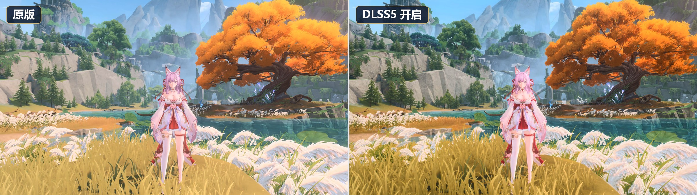
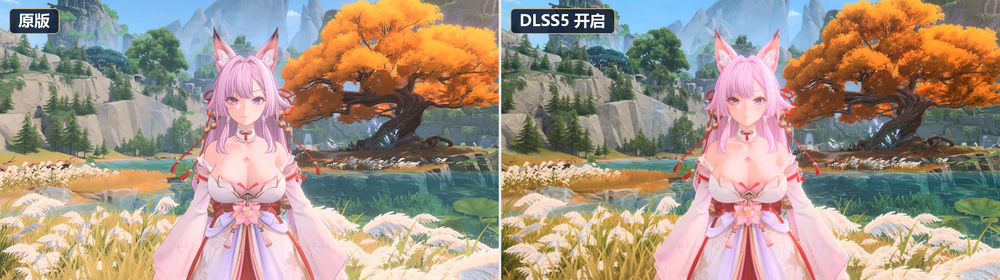
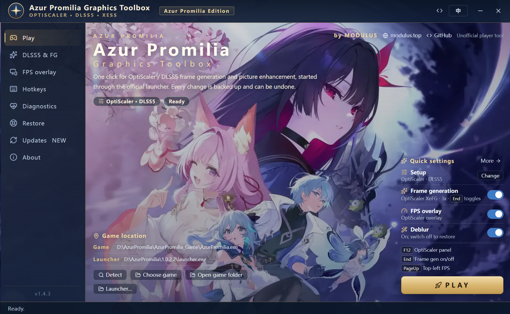
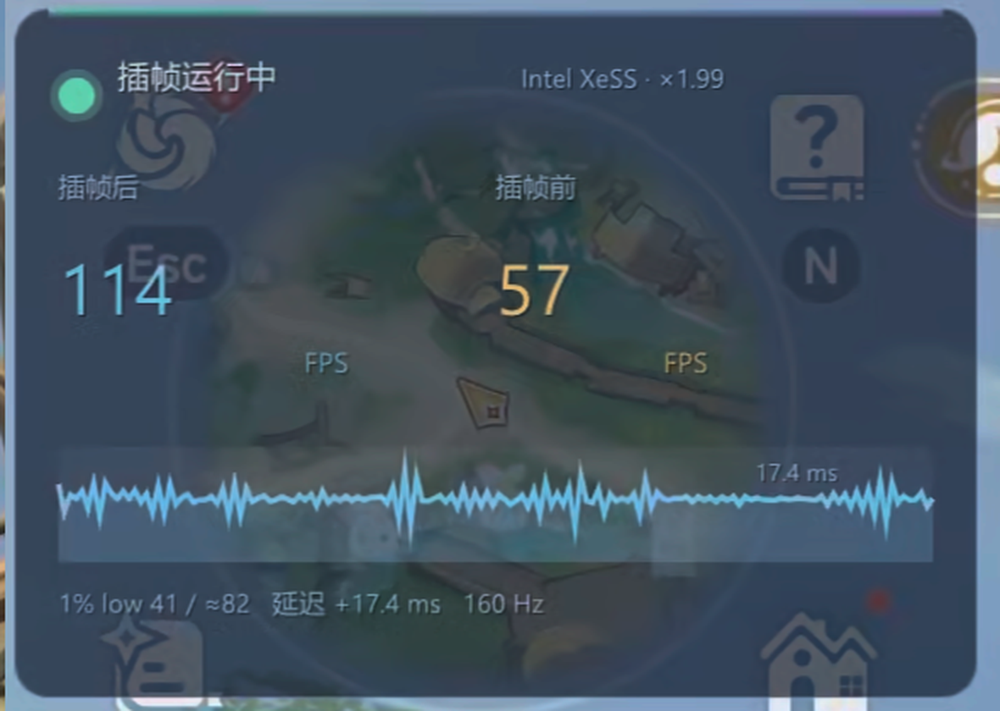

[简体中文](README.md) | **English**

# Azur Promilia Graphics Toolbox

**Enable DLSS5 image enhancement, frame generation, and blur removal for Azur Promilia with one click. Install without tedious manual file replacement.**

Azur Promilia edition · DLSS5 · Intel XeSS · OptiScaler · 简体中文 / English

---

## Visual Comparisons

The left side shows the original game, and the right side shows DLSS5 enabled. Click an image to view it at full resolution.

## Main Interface

## Frame Rate Test

Test system: **NVIDIA GeForce RTX 5080**, **4K resolution with all settings at maximum**, DLSS5 and Intel XeSS frame generation enabled at 2x.

Gameplay typically stays around **80–100 FPS**. At the moment shown below, the game rendered 57 FPS and output **114 FPS** after frame generation.

The built-in frame rate overlay appears in the upper-left corner. It shows frame rates before and after frame generation, a frame-time graph, and added latency. You can toggle it at any time.

## How to Use

To clone this repository with Git, install Git LFS first, then run `git lfs pull` after cloning to download the complete application and resource package.

1. **Download and extract** the archive, then double-click **AzurFrameToolbox.exe**.
2. **Locate the game.** The toolbox automatically searches for Azur Promilia and its official launcher. If it cannot find them, click “Browse…” and select AzurPromilia.exe.
3. **Click “Install Frame Generation Components.”** Installation takes about one or two minutes, and original files are backed up automatically.
4. **Click “Launch Game.”** The toolbox opens the official launcher. Start the game there as usual.
5. **In game,** press **Home** to open the DLSS5 panel and **Ctrl+F10** to toggle the frame rate overlay.

To remove the changes, open “Restore and Uninstall” and select **Restore to Pre-Install State**. The game directory is restored file by file using the installation record.

## Features

- **Two frame generation options you can switch between**
  - **DLSS5:** image enhancement plus Intel XeSS frame generation at 2x. With the DLSS frame generation runtime installed on an NVIDIA GPU, 2x–6x is available.
  - **OptiScaler, Azur Promilia edition:** XeFG frame generation from 2x to 6x, independent of DLSS5 image enhancement. The in-game panel is translated into Chinese, and changes are saved automatically.
- **Frame rate overlay:** three styles, four corner positions, multiple sizes, and optional frame rate CSV recording.
- **Custom hotkeys:** press the key combination you want to use.
- **Diagnostics and feedback:** reads game logs to report whether frame generation is running and why it may not be, with one-click feedback package export.
- **Optional blur removal:** replaces the game’s blur resources and can be reverted at any time.
- **Safe restoration:** files are backed up before changes are written, and failures roll back automatically. Updates open the download page in a browser and never download or run files automatically.

## FAQ

**The panel does not appear when I press Home.**
Open “Panel Compatibility Mode” under “Hotkeys,” or choose a key that does not conflict with another binding.

**Frame generation stops when image enhancement (NR) is disabled in game.**
DLSS5 frame generation depends on NR. Re-enable NR in the DLSS5 panel. You can also enable “Frame Generation” in the toolbox, which enables NR at the same time and takes effect after restarting the game. To avoid this dependency, switch the frame generation source to OptiScaler.

**Frame generation is enabled but does not seem to work.**
Disable Smooth Motion for this game in the NVIDIA App because driver frame generation conflicts with DLSS5. The “Diagnostics and Logs” page also reports this issue.

**How do I restore the original game?**
Open “Restore and Uninstall” and select “Restore to Pre-Install State.”

## System Requirements

- 64-bit Windows 10 or 11
- An NVIDIA RTX GPU is recommended. Testing has focused mainly on RTX 40 and 50 series.

## Notice

This is a third-party tool made by players and is not affiliated with the game’s official publisher. Third-party plugins may violate the game rules, cause crashes, or put your account at risk. Use them at your own discretion.

## Credits and License

- DLSS5 NR, a RenoDX plugin, by Lecram
- [ReShade](https://reshade.me)
- [OptiScaler](https://github.com/optiscaler/OptiScaler), licensed under GPL-3.0.
- Intel XeSS
- Made by MODULUS (模序)
