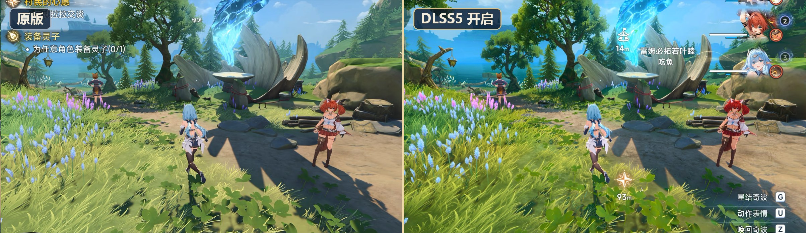
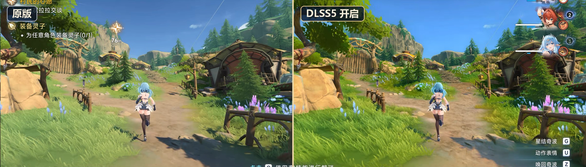
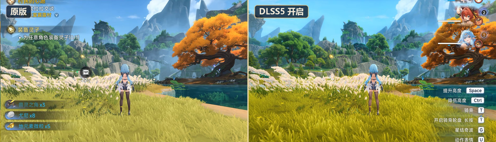
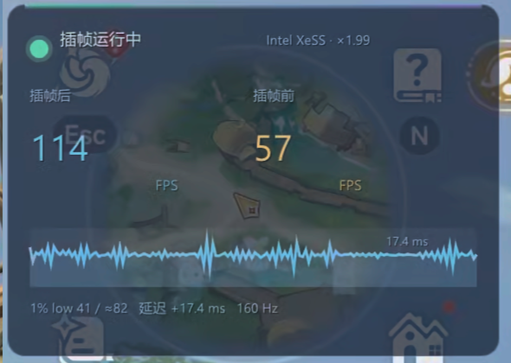

[**简体中文**](README.md) | [English](README.en.md)

# 蓝色星原画质工具箱

**给《蓝色星原》一键开启 DLSS5 画质增强，插帧和反虚化。一键安装，无需繁琐手动替换文件。**

`蓝色星原特供` · DLSS5 · Intel XeSS · OptiScaler · 中文 / English

---

## 效果对比

左边是原版，右边开启了 DLSS5。游戏无法隐藏界面，所以截图里带有 UI。

## 帧率实测

测试设备：**NVIDIA GeForce RTX 5080**，**4K 分辨率，画质全部最高**，开启 DLSS5 + Intel XeSS 插帧（2x）。

日常跑图稳定在 **80–100 帧左右**。下图这一刻：渲染 57 帧，插帧后输出 **114 帧**。

左上角的帧率浮窗是工具箱自带的。它显示插帧前后的帧数、帧时间曲线和增加的延迟，可以随时开关。

## 怎么用

1. **下载并解压**，双击 `AzurFrameToolbox.exe`。
2. **找到游戏**：工具箱会自动查找蓝色星原和官方启动器；没找到就点「手动选择…」，选中 `AzurPromilia.exe`。
3. **点「安装插帧组件」**：大约一两分钟，原文件会自动备份。
4. **点「开始游戏」**：工具箱会打开官方启动器，在启动器里正常进入游戏即可。
5. **游戏内**：按 `Home` 打开 DLSS5 面板，按 `Ctrl+F10` 开关帧率浮窗。

不想用了，到「恢复与卸载」点 **恢复到安装前**，游戏目录会按安装记录逐个还原，不留残留。

## 功能

- **两种插帧方案，随时切换**
  - **DLSS5**：画质增强 + Intel XeSS 插帧（2x）；N 卡装好 DLSS 帧生成运行库后，可选 2x–6x。
  - **OptiScaler（蓝色星原特供版）**：XeFG 插帧 2x–6x，不依赖 DLSS5 的画质增强；游戏内面板中文化，改动自动保存。
- **帧率浮窗**：三种样式、四个角、多档大小，可记录帧率 CSV。
- **快捷键自定义**：直接按下想要的组合键即可。
- **诊断与反馈**：自动读取游戏日志，告诉你插帧有没有在跑、为什么没跑；一键导出反馈包。
- **反虚化（可选）**：替换游戏的虚化资源，可随时撤回。
- **安全可还原**：所有改动先备份再写入，中途失败会自动回滚；更新只会在浏览器里打开下载页，不会自动下载或运行任何东西。

## 常见问题

**按 Home 面板没出来？**
到「快捷键」打开「面板兼容模式」，或者换一个不冲突的按键。

**游戏里关掉了画质增强（NR），插帧就没了？**
DLSS5 的插帧依赖 NR。在 DLSS5 面板里重新打开 NR 即可；也可以在工具箱里打开「插帧」，它会同时打开 NR，重启游戏后生效。想要不受这个限制，可以把插帧来源切到 OptiScaler。

**开了插帧但没有效果？**
在 NVIDIA App 里关掉本游戏的 Smooth Motion（驱动插帧），它会和 DLSS5 冲突。「诊断与日志」页会直接提示这类问题。

**想回到原版？**
「恢复与卸载」→「恢复到安装前」。

## 系统要求

- Windows 10 / 11，64 位
- 推荐 NVIDIA RTX 显卡（主要在 RTX 40/50 系列上测试）；

## 注意

本工具是玩家自制的第三方工具，与游戏官方无关。使用第三方插件可能违反游戏规则，也可能导致崩溃或账号风险，请自行判断。

## 致谢与许可

- DLSS5 NR（RenoDX 插件）：作者 Lecram
- [ReShade](https://reshade.me)
- [OptiScaler](https://github.com/optiscaler/OptiScaler)：GPL-3.0
- Intel XeSS
- 由 MODULUS（模序）制作
